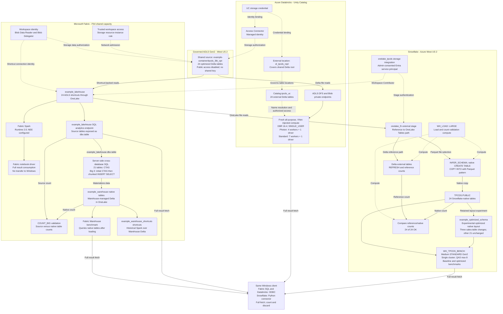

# 02 — Architecture & Data-Access Paths

**Databricks query runtime:** Databricks Runtime 16.4, Scala 2.12
(`16.4.x-scala2.12`), used for both Photon and Standard publication lanes.

Everything runs in **Azure West US 2**. One governed ADLS Gen2 account holds the 3 TB Delta dataset;
each engine reaches it through the paths below. Shared origin does not establish
equivalent semantics, caching or physical storage.

## Topology

Solid arrows show data flow; dashed arrows show authorization, metadata or
compute dependencies. Unity Catalog and storage integrations govern access;
they are not extra dataset copies.

The diagram combines recorded ingestion paths with the October 11-13, 2026
full-result measurements. The Warehouse-shortcut Spark branch is historical,
not an additional lane in the latest results.

## Measurement and Compute Lifecycle

Fabric SQL, Databricks and Snowflake consume full results on the same Windows
host using ODBC for Fabric SQL/Databricks and the native Snowflake Python
connector. Spark consumes results on the Fabric notebook driver; its Windows
ODBC full-result path remains blocked and is not a completed measurement.
Batch timing includes SQL submission through final consumption and inter-query
overhead, but excludes setup and cleanup. It is not billed compute duration.
See [latest results](RESULTS.md) for the separate consumption boundaries.

Fabric used F64 for measured runs. Cleanup after the October 13 SQL pass verified
**F64/Paused**; this is a recorded receipt, not a live status check. Databricks
client runners terminated their owned all-purpose clusters after execution.
These lanes ran serially, not as simultaneous throughput on shared F64.

## Fabric Access and Warehouse Loading

Fabric's workspace identity supplies storage authorization; a resource-instance
rule admits trusted workspace access to the governed account. These are
separate permission and network checks. The ADLS shortcut connection uses that
identity, and OneLake exposes the source Delta without copying it into the
lakehouse. Fabric Spark and the lakehouse SQL endpoint read this shortcut-backed
source. This observed shortcut route does not use a Fabric managed private
endpoint; Databricks' private-endpoint route is separate.

The native Warehouse load was different: the local pyodbc client submitted
cross-database SQL to Fabric; the server read `example_lakehouse.dbo.<table>` and wrote
`example_warehouse.dbo.<table>`. Rows were not downloaded and uploaded by the client.
The 21 smaller tables used one CTAS each. The three largest sales tables used
an initial CTAS followed by chunked `INSERT ... SELECT`, then `COUNT_BIG`
validation. They were loaded at F64 after earlier lower-capacity attempts.

| Large table | Recorded rows | Chunks | Recorded elapsed seconds |
|---|---:|---:|---:|
| `web_sales` | 2,159,930,761 | 4 | 347 |
| `catalog_sales` | 4,320,004,419 | 8 | 576 |
| `store_sales` | 9,177,187,206 | 24 | 2,083 |

These historical load timings total 3,006 seconds for the big three, not all
24 tables; `store_sales` includes a recorded transient stall. They are not
benchmark query timings. Pipeline Copy was a considered alternative, not the
recorded load in this table. Fabric `COPY INTO` was not the successful route
for this private-source/shortcut setup. Native Warehouse queries subsequently
read the Warehouse's materialized copy rather than reloading the ADLS source.

## Databricks Unity Catalog Access

The Unity Catalog setup binds an external location covering the shared Delta
root to an Access Connector-backed storage credential. It registers 24
`USING DELTA LOCATION` external tables in the `tpcds_uc` schema. The latest
Windows-client runs used fresh on-demand all-purpose clusters in the VNet-injected
workspace, not ephemeral job clusters. Both used DBR 16.4 / Scala 2.12 and
Standard_D8ads_v5 nodes: Photon used four workers plus one matching driver;
Standard used seven workers plus one matching driver. All-purpose billing
applies. The separate legacy hosted runner provisions job clusters; that is
not the lifecycle behind the latest client results.
UC resolves table names and authorizes access; compute reads the existing Delta
files through the ADLS DFS/Blob private endpoints. Registration is metadata,
not a native-table data copy. Network reachability alone does not grant data
permissions, and a storage credential alone does not establish network access.

## Snowflake Baseline and Optimized Layouts

The baseline uses native tables loaded through OneLake. A separate experimental
schema retains layout changes to STORE_SALES, CATALOG_SALES and WEB_SALES; the
other 21 tables were unchanged. Original baseline tables were not modified.
The diagram uses a placeholder for the optimized schema, not its private name.
Both layouts ran separately on the same Medium STANDARD Gen2 warehouse, with
one cluster, QAS enabled with maximum scale factor 8 and session result reuse
disabled. QAS configuration is not evidence of usage or actual cost. The LARGE
load warehouse was separate from benchmark compute.

## Why each access path

| Engine | Path to the data | Why this path |
|---|---|---|
| **Fabric Warehouse** | CTAS/INSERT…SELECT from `example_lakehouse` shortcut → **warehouse-managed Delta tables** (V-Order Parquet + `_delta_log`) in OneLake | Polaris owns and V-Order-optimizes its own Delta storage; read by the Polaris MPP engine. Native load is the engine's normal mode (not a non-Delta format). |
| **Fabric Spark (ADLS)** | OneLake **shortcut** in `example_lakehouse` → ADLS `tpcds_3tb_opt` Delta | Shared source files with Databricks; different access and execution paths remain. |
| **Fabric Lakehouse SQL endpoint** | SQL endpoint of `example_lakehouse` → the same ADLS shortcuts | No native Warehouse load; every SELECT bypasses result-set caching. |
| **Fabric Spark (WH)** | OneLake shortcut in `example_warehouse_shortcuts` → warehouse V-Ordered Delta | Historical secondary lane, not part of the latest measured table; shows Spark over the warehouse's own Delta (small-file caveat). |
| **Databricks** | UC external tables on classic VNet compute; historical direct `abfss://` with SP OAuth | UC worked after configuring the Access Connector, storage credential and trusted-resource access. |
| **Snowflake** | **Storage integration → OneLake** → native COPY load | OneLake provides the source access path; the native load creates a separate stored representation, not zero-copy query execution. |

## The governance wall (important)

The subscription **force-locks** `publicNetworkAccess=Disabled` + `allowSharedKeyAccess=false` on **all**
storage accounts (a managed-environment policy above the subscription). Consequences that shaped the design:

- The tested Snowflake direct-ADLS load path was blocked; the OneLake source path
  allowed copying into Snowflake-native tables.
- Early Databricks UC attempts failed with a delegation-key error. UC was later
  verified on classic VNet compute after the Access Connector setup was corrected.
  Do not drop working UC external locations to reproduce the historical workaround.
- Fabric Warehouse `COPY INTO` from the governed ADLS (or its OneLake shortcuts)
  was blocked in this setup. The executed Warehouse load used **CTAS and chunked
  INSERT SELECT**; pipeline Copy was an alternative. Snowflake's separate
  `COPY INTO` through OneLake did succeed.

Full detail and symptoms: [09-troubleshooting.md](09-troubleshooting.md).

## Key identifiers (replace with your own)

| Thing | Value in this run |
|---|---|
| Fabric capacity | `example_capacity` (F64 for measured runs; F64/Paused verified after the October 13 SQL pass) |
| Fabric workspace | `example_workspace` |
| Lakehouse (ADLS shortcuts) | `example_lakehouse` |
| Lakehouse (warehouse shortcuts) | `example_warehouse_shortcuts` |
| Warehouse | `example_warehouse` |
| ADLS account / container | `examplestorage001` / `stage` |
| Dataset path | `abfss://example-container@examplestorage001.dfs.core.windows.net/tpcds_3tb_opt` |
| Databricks workspace | `example-databricks` |
| Snowflake layouts / warehouse | Baseline `TPCDS.PUBLIC` and `example_optimized_schema` / `WH_TPCDS_BENCH` (Medium STANDARD Gen2; single cluster; QAS max 8) |
